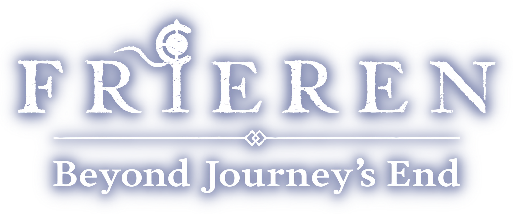
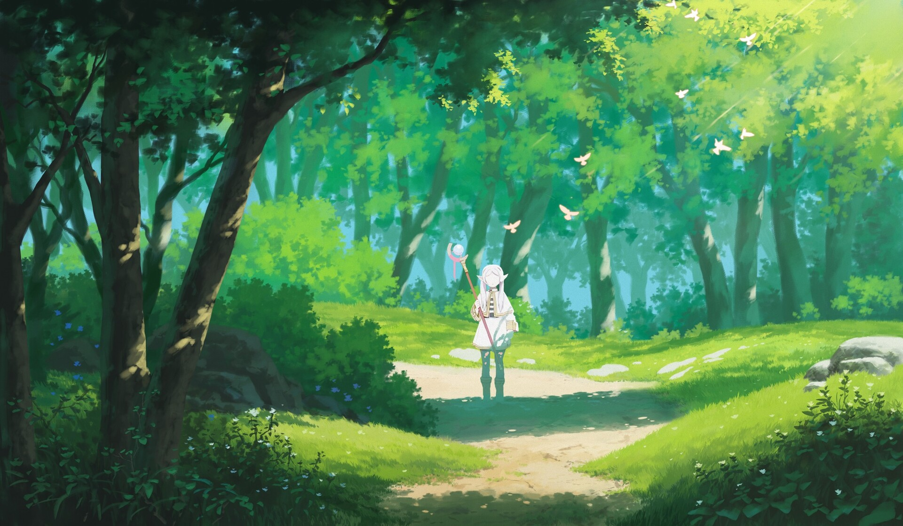

<div align="center">



# ✨ Frieren: Beyond Journey's End — Landing Page

*A fan-made, animated landing page inspired by the anime **Sousou no Frieren**.*

[](https://react.dev/)
[](https://www.typescriptlang.org/)
[](https://vite.dev/)
[](https://tailwindcss.com/)
[](https://motion.dev/)
[](https://www.i18next.com/)



</div>

---

## 🌸 Features

| | Feature | Description |
|---|---|---|
| ⏳ | **Loading screen** | Animated intro before the page is revealed |
| 🎵 | **Background music** | Built-in player with play/pause, mute and volume, with autoplay handling across browsers |
| 🖼️ | **Gallery** | Asymmetric photo grid with smooth animations |
| 🧙 | **Characters** | Cards for Frieren, Fern and Stark |
| 🎬 | **AMV section** | Fan-made music videos with thumbnails |
| 🌍 | **Multi-language** | English, Bahasa Indonesia, 한국어, 日本語 and 中文 |
| 📱 | **Responsive** | Looks good on desktop and mobile |

## 🛠️ Tech Stack

- **[React 19](https://react.dev/)** + **[TypeScript](https://www.typescriptlang.org/)** — UI and type safety
- **[Vite 7](https://vite.dev/)** — fast dev server and build
- **[Tailwind CSS 4](https://tailwindcss.com/)** — styling
- **[Framer Motion](https://motion.dev/)** — animations
- **[Radix UI](https://www.radix-ui.com/)** + **[Lucide](https://lucide.dev/)** — accessible components and icons
- **[i18next](https://www.i18next.com/)** — translations

## 🚀 Getting Started

**Requirements:** [Node.js](https://nodejs.org/) 20 or newer.

```bash
# 1. Clone the repository
git clone https://github.com/willsyh/frieren-landing-page-main.git
cd frieren-landing-page-main

# 2. Install dependencies
npm install

# 3. Start the dev server
npm run dev
```

Then open **http://localhost:5173** in your browser.

### Available Scripts

| Command | What it does |
|---|---|
| `npm run dev` | Start the local dev server |
| `npm run build` | Type-check and build for production into `dist/` |
| `npm run preview` | Preview the production build locally |
| `npm run lint` | Run ESLint |

## 📁 Project Structure

```
frieren-landing-page-main/
├── public/              # Images, AMV videos, thumbnails, music
├── src/
│   ├── components/
│   │   ├── loadingScreen.tsx
│   │   └── ui/          # NavBar, Banner, Gallery, Characters, AMV, Music player
│   ├── lib/utils.ts
│   ├── i18n.ts          # Translations (en, id, ko, ja, zh)
│   ├── App.tsx
│   └── main.tsx
└── vite.config.ts
```

## 🌍 Adding a Language

1. Open [`src/i18n.ts`](src/i18n.ts) and add a new entry to `resources` (copy the `en` block and translate it).
2. Add the language to the language picker in [`src/components/ui/NavBar.tsx`](src/components/ui/NavBar.tsx).

## 💼 Need a Developer?

Hi! 👋 I'm a fullstack web developer. If you have a design ready, or need a complete system built, I'd love to help.

📩 **[willsyh25@gmail.com](mailto:willsyh25@gmail.com)**

## ⚠️ Disclaimer

This is a non-commercial fan project. *Frieren: Beyond Journey's End* and all related characters, images and music belong to their respective owners (Kanehito Yamada, Tsukasa Abe, Shogakukan and Madhouse).

<div align="center">

---

Made with 💜 by [willsyh](https://github.com/willsyh) · If you like it, give it a ⭐

</div>
